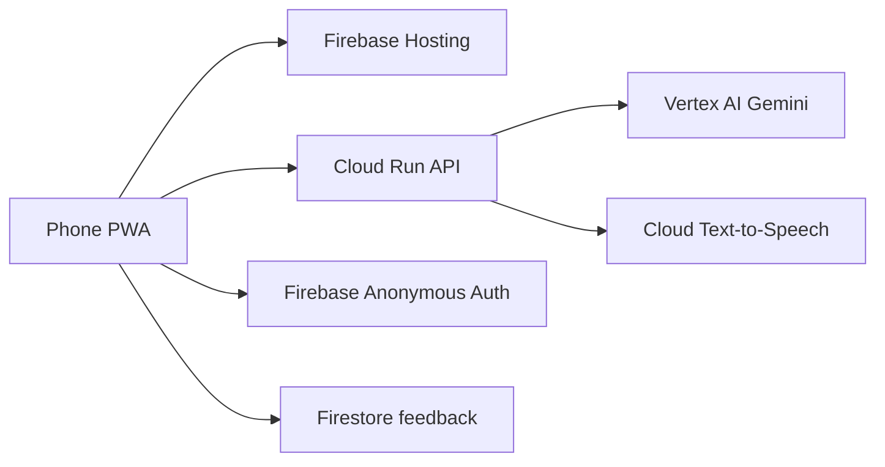

# Sarvam

Paperwork, explained in your language.

Sarvam reads a notice, bill, letter or report and explains what it says and what to do next. It speaks and writes in English, Tamil, Hindi, Telugu, Malayalam, Kannada, Marathi, Bengali and Odia.

[Live app](https://sarvam-510715.web.app) · [Demo video](https://youtu.be/uju7hKk9GzU) · [Project deck](docs/Sarvam_AI_Builder_Cup_2026_Deck.pdf)

Built for the Google Cloud AI Builder Cup 2026 by Vigneshwaran and Abraham Donald T.


## Screens

| Home | A result | Listen |
| --- | --- | --- |
|  |  |  |

## What it does

- Take a photo or choose a PDF. Several pages are read together. A health checkup can arrive as a lab report, a prescription and a bill in one file.
- Explain the document in the language you choose, in short sentences.
- Listen to that explanation, or ask a question by typing or by speaking.
- Show where a fact came from. Each important value is **Found in your document**, **Calculated**, or **Check against original**.
- Save a result on this phone, add a date to your calendar, and share a version with personal details hidden.
- Eleven fictional samples are built in, so you can try it without uploading anything: a lab report, an insurance letter, a pension notice, a phone invoice and warranty, a property tax notice, a traffic e-challan, a prescription, a mutual fund statement, a court summons, a bank deposit slip, and a health checkup.

Sarvam explains the document. It does not replace a doctor, an insurer, a lawyer or a government office.

## How we use Google Cloud



- **Gemini 3.7 Flash** on Vertex AI reads the document, translates it, answers questions and transcribes a short recording. If that call fails in a way that can be tried again, Sarvam uses **Gemini 2.5 Flash**.
- **Cloud Run** (`asia-south1`) hosts the FastAPI service.
- **Cloud Text-to-Speech** (Chirp 3 HD) speaks English, Tamil, Hindi, Telugu, Malayalam, Kannada, Marathi and Bengali. Odia uses the phone's own voice.
- **Firebase Hosting** serves the app. **Anonymous Auth** signs the phone in. **Firestore** stores the optional rating, not the document.

## Privacy

The document is sent to Vertex AI so it can be read. Sarvam does not keep a library of uploaded files. A result you choose to save stays on this phone. A microphone recording used for Ask is transcribed and then dropped. Share can hide names, numbers and other personal details before anything leaves the phone.

## Run it locally

You need Python 3.12 or newer, Node.js 20 or newer, and Google Cloud application-default credentials for project `sarvam-510715`.

```bash
cd api
python3 -m venv .venv
source .venv/bin/activate
pip install -r requirements.txt
uvicorn main:app --reload --port 8080
```

```bash
cd web
npm install
npm run dev
```

Open [http://localhost:5173](http://localhost:5173). The web app reads `VITE_API_URL` from `web/.env` (see `web/.env.example`). For a phone on the same Wi-Fi, use the laptop's network address instead of `localhost`. The deploy steps are in [DEPLOY.md](DEPLOY.md).

## Tests

```bash
cd api && .venv/bin/python -m pytest -q
cd web && node --test
```

`cd web && npm run build` typechecks and builds the app.

## Repository

| Path | What it is |
| --- | --- |
| `web/` | React, TypeScript and Vite phone app |
| `api/` | FastAPI service |
| `web/public/samples/` | Fictional sample documents |
| `docs/` | Deck, screenshots and the original build brief |
| `design/sarvam-v3/` | Design screens the app was built from. Tests read the expected-facts file here, so this folder stays at this path |
| `DEPLOY.md` | How the live API and the website are deployed |

## Known limits

- Odia has no Chirp voice on the server. Listen for Odia uses the phone's voice when the phone has one.
- Word files are not accepted. Use a PDF or a photo.
- The samples are fictional. They are not real people's documents.
