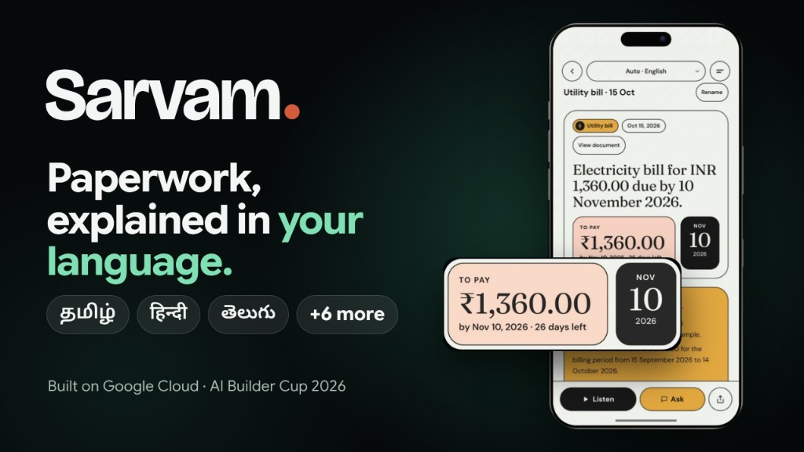
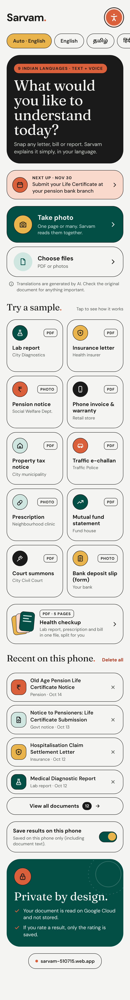
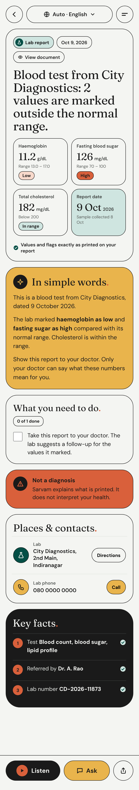
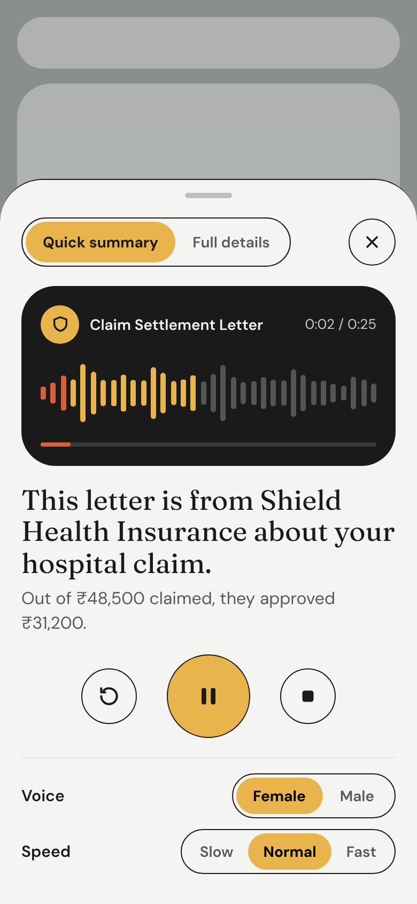
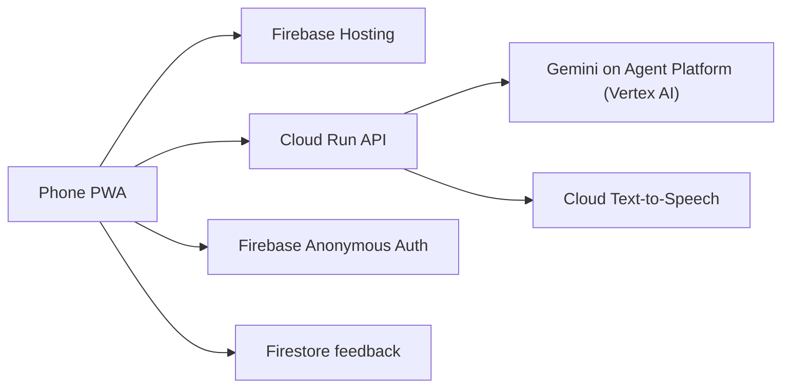

# Sarvam

Paperwork, explained in your language.

Sarvam reads a notice, bill, letter or report and explains what it says and what to do next. It speaks and writes in English, Tamil, Hindi, Telugu, Malayalam, Kannada, Marathi, Bengali and Odia (spoken audio is not available for Odia yet).

[Live app](https://sarvam-510715.web.app) · [Demo video](https://youtu.be/uju7hKk9GzU) · [Project deck](docs/Sarvam_AI_Builder_Cup_2026_Deck.pdf)

Built for the Google Cloud AI Builder Cup 2026 by Vigneswaran (team leader) and Abraham Donald T.

Built with the help of AI coding assistants, including Google Antigravity.



## Screens

| Home | A result | Listen |
| --- | --- | --- |
|  |  |  |

## For judges: test it in two minutes

### Before you start

- No sign-in. Open the [live app](https://sarvam-510715.web.app) on a phone or a laptop browser.
- Samples are fictional. Files are in `web/public/samples/` and `samples/`.

### A 60-second test

1. Tap **English**.
2. Under **Try a sample**, tap **Health checkup** (PDF · 5 PAGES).
3. The chip says **3 documents**. **In this upload** is the page map. Tap **Ask**.

| Question | What to expect |
| --- | --- |
| Which lab values are outside the range? | Fasting blood sugar 118 mg/dL (70 – 100) High; HbA1c 6.1 % (4.0 – 5.6) High; Total cholesterol 212 mg/dL (Below 200) High; LDL 138 (Below 130) High; Vitamin D (25-OH) 18 ng/mL (30 – 100) Low. A quote and **From your document**. |
| What is the patient's blood group? | **This document doesn't say.** |
| Why can haemoglobin be low? | **General information, not from your document**. |

Ask uses the language you chose. Try தமிழ் or हिंदी.

Ask follows instructions given to Gemini, so the wording can vary a little from the expected results above.

### Try these too

- **Listen**: Chirp 3 HD in 8 languages. Spoken audio is not available for Odia yet.
- **Hide personal details** on: names, phones and IDs are masked.
- **Pension notice** in Tamil: life certificate by 30 Nov 2026, plus the days left.

### Where the facts come from, and the guardrails

- Only the file you give. No web search. Saved results stay on the phone (IndexedDB). Firestore stores only an optional rating, and it cannot be read back.
- Code sets the label (`verify_evidence` in `api/evidence.py`): **Found in your document**, **Calculated**, or **Check against original**. A PDF is Found only when the quote and its numbers are in the text (`extract_critical_tokens`). A photo is never Found. In a PDF, amounts, dates and phone numbers inside a quote are checked against the page text. A lab value is checked as its label plus its value on the page.
- A number missing from the document is not Found (`verify_translation_guard`, `verify_spoken_summary_digit_guard`). A flag printed on the report (High, Low, H, L or an arrow) wins. If the report prints none, the phone compares the value with the range printed on the report and can show Above range or Below range. A translation must keep the original numbers (`verify_translation_guard`), and a spoken summary that adds a number is replaced (`verify_spoken_summary_digit_guard`).
- `check_script_guard` checks the script and asks again if it fails. It covers Tamil, Hindi, Marathi, Telugu, Malayalam, Kannada and Bengali. Odia is checked on the phone. Masking runs on the phone and at `/api/redact` (`api/redact.py`). If it fails, the share is shorter (`failClosedShare`).
- `cd api && .venv/bin/python -m pytest -q` and `cd web && node --test`. Evals: `api/evals/`.

### How we kept it fast and cheap

- Written in the chosen language. Translation runs only if `outputNeedsTranslation` says the text is still wrong.
- Cached by SHA-256, language and reader version (`web/src/utils/readCache.ts`). The same file again makes no AI call. Samples are pre-explained in 9 languages (`web/public/samples/results/`). Cloud Run keeps one warm instance.
- Live, 14–15 Oct 2026: 211/211 facts. 16/17 uploads (one Hindi PDF timed out at 90 s). English median 17 s (n=7); 1-page PDF 13 s; Hindi 15.6 s; Tamil 17.0 s; 5-page PDF 45 s; photo 71 s. Ask median 7.5 s (n=3). Hide on: 0 leaks (96 results + 4 uploads). 96/99 languages open. Again: about 0.5 s, 0 AI calls, vs about 23 s (15 Oct). Lighthouse mobile 85, 94, 100. Tests: 252 at the 14–15 Oct check (131 API, 121 web).

Small samples; measured by automated end-to-end tests on the deployed app, 14–15 Oct 2026.

### Limits and quotas

- Per IP each minute: Explain 20, Ask 20, Translate 30, Listen 60.
- PDF 20 MB; total 25 MB; 10 photos or 5 PDFs. No Word files. A locked PDF asks for the password.
- Explain: 80 s on the server; the phone waits 90 s (photo) or 150 s (PDF). Ask: 45 s on the server. Cloud Run: up to 4 instances.
- Busy Gemini (503 or 429): switches to Gemini 2.5 Flash and retries there. Samples still open.

## What it does

- Take a photo or choose a PDF. Several pages are read together. A health checkup can arrive as a lab report, a prescription and a bill in one file.
- Explain the document in the language you choose, in short sentences.
- Listen to that explanation, or ask a question by typing or by speaking.
- Show where a fact came from. Each important value is **Found in your document**, **Calculated**, or **Check against original**.
- Save a result on this phone, add a date to your calendar, and share a version with personal details hidden.
- Eleven fictional samples are built in, so you can try it without uploading anything: a lab report, an insurance letter, a pension notice, a phone invoice and warranty, a property tax notice, a traffic e-challan, a prescription, a mutual fund statement, a court summons, a bank deposit slip, and a health checkup.

Sarvam explains the document. It does not replace a doctor, an insurer, a lawyer or a government office.

## How we use Google Cloud



- **Gemini 3.7 Flash** on Gemini Enterprise Agent Platform (formerly Vertex AI) reads the document, translates it, answers questions and transcribes a short recording. If that call fails in a way that can be tried again, Sarvam uses **Gemini 2.5 Flash**.
- **Cloud Run** (`asia-south1`) hosts the FastAPI service.
- **Cloud Text-to-Speech** (Chirp 3 HD) speaks English, Tamil, Hindi, Telugu, Malayalam, Kannada, Marathi and Bengali. Spoken audio is not available for Odia yet.
- **Firebase Hosting** serves the app. **Anonymous Auth** signs the phone in. **Firestore** stores the optional rating, not the document.

## Privacy

The document is sent to Vertex AI so it can be read. Sarvam does not keep a library of uploaded files. A result you choose to save stays on this phone. A microphone recording used for Ask is transcribed and then dropped. Share can hide names, numbers and other personal details before anything leaves the phone.

## Run it locally

You need Python 3.12 or newer, Node.js 20 or newer, and Google Cloud application-default credentials for project `sarvam-510715`.

```bash
cd api
python3 -m venv .venv
source .venv/bin/activate
pip install -r requirements.txt
uvicorn main:app --reload --port 8080
```

```bash
cd web
npm install
npm run dev
```

Open [http://localhost:5173](http://localhost:5173). The web app reads `VITE_API_URL` from `web/.env` (see `web/.env.example`). For a phone on the same Wi-Fi, use the laptop's network address instead of `localhost`. The deploy steps are in [DEPLOY.md](DEPLOY.md).

## Tests

```bash
cd api && .venv/bin/python -m pytest -q
cd web && node --test
```

`cd web && npm run build` typechecks and builds the app.

## Repository

| Path | What it is |
| --- | --- |
| `web/` | React, TypeScript and Vite phone app |
| `api/` | FastAPI service |
| `web/public/samples/` | Fictional sample documents |
| `docs/` | Deck, screenshots and the original build brief |
| `design/sarvam-v3/` | Design screens the app was built from. Tests read the expected-facts file here, so this folder stays at this path |
| `DEPLOY.md` | How the live API and the website are deployed |

## Known limits

- Spoken audio is not available for Odia yet. Odia has no Chirp voice on the server. For the other eight languages, if Chirp fails, Listen falls back to the phone's own voice.
- Word files are not accepted. Use a PDF or a photo.
- The samples are fictional. They are not real people's documents.
- A 5-page PDF can take about 45 s, and a photo about 71 s (measured 14–15 Oct 2026).
- A photo has no text layer, so a value is never labelled Found in your document.


## What I built at the buildathon (20 Nov 2026)

### What existed before this branch
Before this buildathon branch (`feat/buildathon-live-relay`, branched from `main` at commit `3a69b3d`), Sarvam was a single-user document reader: upload or snap a notice/bill/report, read the plain-language explanation in 9 Indian languages, ask follow-up questions about that document, listen aloud, share redacted summaries, and save reminders/calendar events.

### What was built on 20 Nov 2026 (branch `feat/buildathon-live-relay`, range `3a69b3d..HEAD`)
1. **Live Relay — Live video mode & scanned pages**:
   - Animated 3-scene intro card (`RelayIntro`) on Sarvam's cream background, with reduced-motion fallback.
   - Real-time 1 fps camera + continuous bidirectional Gemini Live voice mode (`CameraScreen`) with Pause video, Flip camera, Freeze and ask, 10-minute idle cost guard, and desktop 430 px centered phone frame.
   - Multi-page scanner (up to 10 pages) with full-screen pinch-to-zoom / swipe `PageViewer`, 3-detent draggable `LiveSheet` (`collapsed` / `half` / `full`), `"Add page"` from the sheet without restarting Gemini, and iPhone audio reliability (`AudioWorklet` ready queue, `navigator.audioSession = 'play-and-record'`, `"Tap to turn on sound"` recovery banner).
2. **Seamless conversation reliability in noisy rooms**:
   - Pure local `ConversationGate` (20 ms PCM16 frames, 1.5 s adaptive noise floor, 300 ms pre-roll, 700 ms hangover, playback echo ducking, Hold-to-Talk fallback).
   - False barge-in guard (ignores server `"interrupted"` unless local speech >= 200 ms occurred within 400 ms).
   - Turn state machine + watchdogs (`relayTurnState.ts`: 6 s `"Still thinking…"` + nudge, 12 s resumption reconnect + resend, 20 s friendly retry, 5 s speaking stall guard, 30 s socket silence ping) and `TranscriptAssembler` + `sanitizeCaption`.
3. **Invite family video room (LiveKit Cloud) + Gemini in the room**:
   - Host taps **Invite family** -> gets QR code, 4-character room code, WhatsApp share link, Copy link, `"Guests can show their camera"` toggle, and live member list, publishing existing camera/mic tracks without disturbing Gemini.
   - Code-split guest route `/r/:code` (`RoomGuest.tsx`, 17 kB chunk with zero Gemini SDK code) — family joins with name, language, and mic on, no login required.
   - Host per-source gated audio mixer (`RoomAudioMixerGraph`) feeds host + remote guest speech to Gemini while strictly rejecting feedback from Gemini's own `"gemini"` output track broadcast back to the room.
   - Debounced speaker notes `"(Name is speaking, Language)"`, reliable caption broadcast over LiveKit data channel with optional Vertex Gemini Flash caption translation (`/api/relay/translate`, 2 s timeout with graceful fallback), one-active-camera-at-a-time handoff (`/api/relay/permissions`), pinned page thumbnail broadcast (`<= 150 KB`), and **End and save** into IndexedDB `relaySessions` (opens read-only transcript + pages from Recent).
4. **Form fill to PDF (merged from Lane B)**:
   - Detects form fields (including character grids and checkboxes) via Vertex Gemini (`/api/formfill/detect`), extracts spoken/typed values (`/api/formfill/extract`), autofills from on-device **My details**, keeps signatures blank (`sign by hand`), exports a filled PDF via `pdf-lib`, and launches from Home, Live camera (`"Fill a form"` chip), or Ask (`"fill this form"`).
5. **Ask Sarvam on Home (merged from Lane B)**:
   - On-device Unicode search across saved documents, form drafts, reminders, and Live Relay transcripts (`IndexedDB`), returning grounded answers with tappable source cards and explicit-approval reminder / calendar cards (nothing is saved without a tap).

### Architecture

```text
  [Host Phone (iPhone / Chrome)]                [Guest Phone (/r/CODE, no login)]
  ├── Camera + Mic ──► LiveKit Cloud (WebRTC) ◄──► Guest Mic (+ optional Guest Camera)
  │       │                     ▲                             │
  │       ▼                     │ "gemini" audio track        │ reliable data channel
  │  Per-source gated mixer     │ + captions + pins + handoff │ (captions, pins, requests)
  │       │                     │                             ▼
  │       ▼                     │                    [RoomGuest (17 kB split chunk)]
  │  Gemini Live API ───────────┘
  │  (Firebase AI Logic / Vertex AI)
  │
  ├── On-device IndexedDB (sarvam_db v5): recent_results, relaySessions, profile, drafts, reminders
  └── FastAPI (Cloud Run: sarvam-relay-api)
        ├── /api/relay/{rooms,join,settings,end,permissions,translate,health}
        └── /api/formfill/{detect,extract}  (Vertex Gemini Flash via api/reader.py get_client)
```

### How Google AI & Google Cloud are used
- **Gemini Live API via Firebase AI Logic** (`gemini-3.8-live` with automatic fallback to `gemini-live-2.5-flash-native-audio`): real-time multimodal voice + 1 fps video conversation on the host, authenticated via a named Firebase app (`'relay'`) and App Check.
- **Vertex AI Gemini Flash** (`api/reader.py` `get_client()`): document explanation, form field bounding-box detection & spoken value extraction, and optional cross-language room caption translation.
- **Cloud Run (`sarvam-relay-api`, `asia-south1`)** + **Secret Manager**: token minting, LiveKit room lifecycle/permissions, form-fill endpoints, and caption translation — isolated from production `sarvam-api`.
- **Firebase Hosting preview channel (`relay`)**: deploys the buildathon prototype without touching the live site.

### Running locally (Live Relay + Form Fill + Ask)

```bash
# Terminal 1: API (with api/.env.relay.local containing LIVEKIT_URL, LIVEKIT_API_KEY, LIVEKIT_API_SECRET)
cd api
set -a && source .env.relay.local && set +a
.venv/bin/uvicorn main:app --host 0.0.0.0 --port 8000 --reload

# Terminal 2: Web (with web/.env.relay.local)
cd web
VITE_API_URL=http://127.0.0.1:8000 npm run dev -- --mode relay --host
```

See [docs/buildathon/DEPLOY.md](docs/buildathon/DEPLOY.md) for Cloud Run and Firebase Hosting preview channel deploy commands, and [docs/buildathon/STATUS.md](docs/buildathon/STATUS.md) for verified test counts.

### Privacy rules enforced in code
- Memory, saved Live Relay sessions, chats, **My details**, and form drafts live **on-device only** (IndexedDB).
- The shared Gemini Live session never receives private memory or personal details unless the user explicitly taps Share.
- Nothing is added to reminders, calendar, or sent without an explicit user tap.
- ID numbers are never read aloud by Gemini; form signatures are always left blank to sign by hand.
- Audio, page images, and caption contents are never logged on the server.

### Buildathon known limits
- LiveKit Cloud free tier is used for WebRTC media relay (rooms capped at host + 3 guests, 30 min idle / 3 h max).
- iPhone Safari requires a user gesture to unlock Web Audio; if audio starts suspended, the `"Tap to turn on sound"` banner resumes it in one tap, and the hardware ring/silent switch must be unmuted.
- Deployed to a Firebase Hosting preview channel (`relay`), not the live production channel.
- Gmail integration (P6) was intentionally excluded from this build to keep production OAuth safe.
