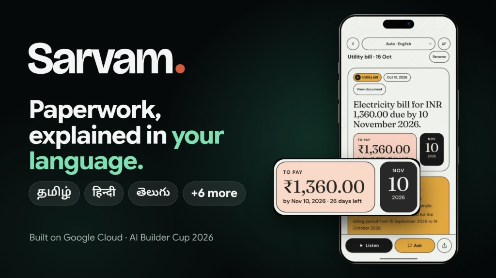
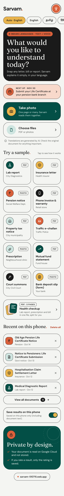
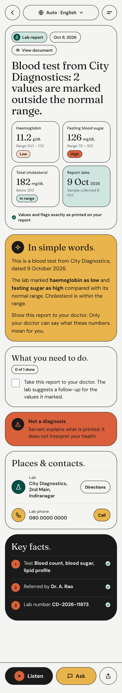
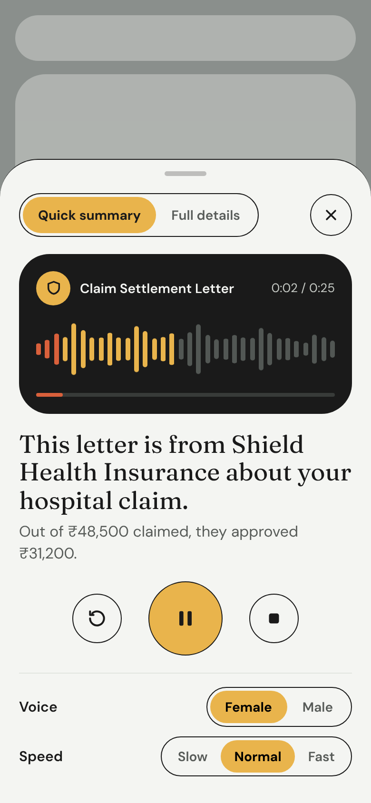
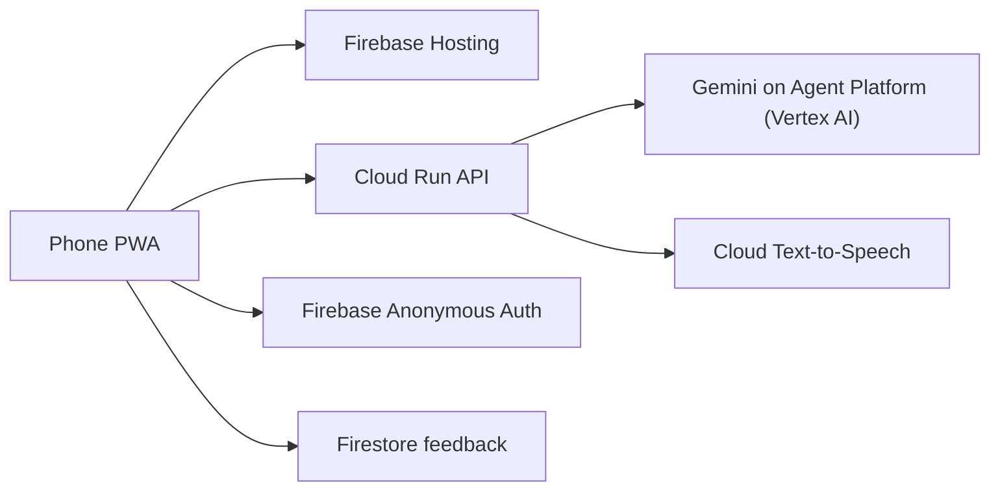

# Sarvam

Paperwork, explained in your language.

Sarvam reads a notice, bill, letter or report and explains what it says and what to do next. It speaks and writes in English, Tamil, Hindi, Telugu, Malayalam, Kannada, Marathi, Bengali and Odia.

[Live app](https://sarvam-510715.web.app) · [Demo video](https://youtu.be/uju7hKk9GzU) · [Project deck](docs/Sarvam_AI_Builder_Cup_2026_Deck.pdf)

Built for the Google Cloud AI Builder Cup 2026 by Vigneswaran (team leader) and Abraham Donald T.



## Screens

| Home | A result | Listen |
| --- | --- | --- |
|  |  |  |

## For judges: test it in two minutes

### Before you start

- No sign-in. Open the [live app](https://sarvam-510715.web.app) on a phone or a laptop browser.
- Samples are fictional. Files are in `web/public/samples/` and `samples/`.

### A 60-second test

1. Tap **English**.
2. Under **Try a sample**, tap **Health checkup** (PDF · 5 PAGES).
3. The chip says **3 documents**. **In this upload** is the page map. Tap **Ask**.

| Question | What to expect |
| --- | --- |
| Which lab values are outside the range? | Fasting blood sugar 118 mg/dL (70 – 100) High; HbA1c 6.1 % (4.0 – 5.6) High; Total cholesterol 212 mg/dL (Below 200) High; LDL 138 (Below 130) High; Vitamin D (25-OH) 18 ng/mL (30 – 100) Low. A quote and **From your document**. |
| What is the patient's blood group? | **This document doesn't say.** |
| Why can haemoglobin be low? | **General information, not from your document**. |

Ask uses the language you chose. Try தமிழ் or हिंदी.

### Try these too

- **Listen**: Chirp 3 HD in 8 languages. Odia uses the phone's voice.
- **Hide personal details** on: names, phones and IDs are masked.
- **Pension notice** in Tamil: life certificate by 30 Nov 2026, plus the days left.

### Where the facts come from, and the guardrails

- Only the file you give. No web search. Saved results stay on the phone (IndexedDB). Firestore stores only an optional rating, and it cannot be read back.
- Code sets the label (`verify_evidence` in `api/evidence.py`): **Found in your document**, **Calculated**, or **Check against original**. A PDF is Found only when the quote and its numbers are in the text (`extract_critical_tokens`). A photo is never Found.
- A number missing from the document is not Found (`verify_translation_guard`, `verify_spoken_summary_digit_guard`). Lab flags are only High, Low, H, L or an arrow printed on the page.
- `check_script_guard` checks the script and asks again if it fails. Masking runs on the phone and at `/api/redact` (`api/redact.py`). If it fails, the share is shorter (`failClosedShare`).
- `cd api && .venv/bin/python -m pytest -q` and `cd web && node --test`. Evals: `api/evals/`.

### How we kept it fast and cheap

- Written in the chosen language. Translation runs only if `outputNeedsTranslation` says the text is still wrong.
- Cached by SHA-256, language and reader version (`web/src/utils/readCache.ts`). The same file again makes no AI call. Samples are pre-explained in 9 languages (`web/public/samples/results/`). Cloud Run keeps one warm instance.
- Live, 14–15 Oct 2026: 211/211 facts. 16/17 uploads (one Hindi PDF timed out at 90 s). English median 17 s (n=7); 1-page PDF 13 s; Hindi 15.6 s; Tamil 17.0 s; 5-page PDF 45 s; photo 71 s. Ask median 7.5 s (n=3). Hide on: 0 leaks (96 results + 4 uploads). 96/99 languages open. Again: about 0.5 s, 0 AI calls, vs about 23 s (15 Oct). Lighthouse mobile 85, 94, 100. Tests 252 (131 API, 121 web).

Small samples; measured by automated end-to-end tests on the deployed app, 14–15 Oct 2026.

### Limits and quotas

- Per IP each minute: Explain 20, Ask 20, Translate 30, Listen 60.
- PDF 20 MB; total 25 MB; 10 photos or 5 PDFs. No Word files. A locked PDF asks for the password.
- Explain: 80 s on the server; the phone waits 90 s (photo) or 150 s (PDF). Ask: 45 s on the server. Cloud Run: up to 4 instances.
- Busy Gemini (503 or 429): retry, then Gemini 2.5 Flash. Samples still open.

## What it does

- Take a photo or choose a PDF. Several pages are read together. A health checkup can arrive as a lab report, a prescription and a bill in one file.
- Explain the document in the language you choose, in short sentences.
- Listen to that explanation, or ask a question by typing or by speaking.
- Show where a fact came from. Each important value is **Found in your document**, **Calculated**, or **Check against original**.
- Save a result on this phone, add a date to your calendar, and share a version with personal details hidden.
- Eleven fictional samples are built in, so you can try it without uploading anything: a lab report, an insurance letter, a pension notice, a phone invoice and warranty, a property tax notice, a traffic e-challan, a prescription, a mutual fund statement, a court summons, a bank deposit slip, and a health checkup.

Sarvam explains the document. It does not replace a doctor, an insurer, a lawyer or a government office.

## How we use Google Cloud



- **Gemini 3.7 Flash** on Gemini Enterprise Agent Platform (formerly Vertex AI) reads the document, translates it, answers questions and transcribes a short recording. If that call fails in a way that can be tried again, Sarvam uses **Gemini 2.5 Flash**.
- **Cloud Run** (`asia-south1`) hosts the FastAPI service.
- **Cloud Text-to-Speech** (Chirp 3 HD) speaks English, Tamil, Hindi, Telugu, Malayalam, Kannada, Marathi and Bengali. Odia uses the phone's own voice.
- **Firebase Hosting** serves the app. **Anonymous Auth** signs the phone in. **Firestore** stores the optional rating, not the document.

## Privacy

The document is sent to Vertex AI so it can be read. Sarvam does not keep a library of uploaded files. A result you choose to save stays on this phone. A microphone recording used for Ask is transcribed and then dropped. Share can hide names, numbers and other personal details before anything leaves the phone.

## Run it locally

You need Python 3.12 or newer, Node.js 20 or newer, and Google Cloud application-default credentials for project `sarvam-510715`.

```bash
cd api
python3 -m venv .venv
source .venv/bin/activate
pip install -r requirements.txt
uvicorn main:app --reload --port 8080
```

```bash
cd web
npm install
npm run dev
```

Open [http://localhost:5173](http://localhost:5173). The web app reads `VITE_API_URL` from `web/.env` (see `web/.env.example`). For a phone on the same Wi-Fi, use the laptop's network address instead of `localhost`. The deploy steps are in [DEPLOY.md](DEPLOY.md).

## Tests

```bash
cd api && .venv/bin/python -m pytest -q
cd web && node --test
```

`cd web && npm run build` typechecks and builds the app.

## Repository

| Path | What it is |
| --- | --- |
| `web/` | React, TypeScript and Vite phone app |
| `api/` | FastAPI service |
| `web/public/samples/` | Fictional sample documents |
| `docs/` | Deck, screenshots and the original build brief |
| `design/sarvam-v3/` | Design screens the app was built from. Tests read the expected-facts file here, so this folder stays at this path |
| `DEPLOY.md` | How the live API and the website are deployed |

## Known limits

- Odia has no Chirp voice on the server. Listen for Odia uses the phone's voice when the phone has one.
- Word files are not accepted. Use a PDF or a photo.
- The samples are fictional. They are not real people's documents.
- A 5-page PDF can take about 45 s, and a photo about 71 s (measured 14–15 Oct 2026).
- A photo has no text layer, so a value is never labelled Found in your document.
